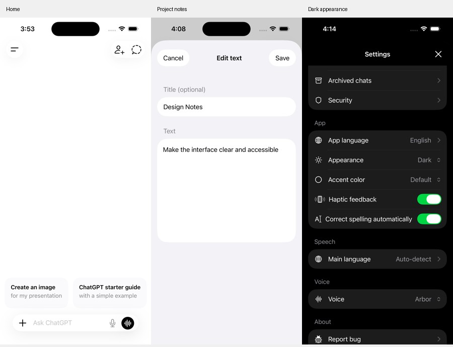

# ChatGPT Swift Demo · Revyl

A native SwiftUI demo built and verified on cloud iPhones with [Revyl](https://revyl.ai). Chat, auth, images, and voice are mocked locally—no backend or API key required.



## Run

Open `ChatGPTDemo.xcodeproj` in Xcode and run the `ChatGPTDemo` scheme on an iPhone simulator (iOS 17+).

For instant access, set these launch environment variables:

```text
DEMO_AUTH_BYPASS=1
DEMO_SEED_DATA=1
```

Optional: change `DEMO_RESET_TOKEN` to reset local data. For manual login, use any demo email, an 8+ character password, and code `123456`.

## Revyl

Cloud builds and GitHub PR review are configured in [`.revyl/config.yaml`](.revyl/config.yaml). Proof of changes is enabled. Forks need their own Revyl project and GitHub connection.

[Verification notes](evidence/verification.md) · [Design reference](https://mobbin.com/apps/chat-gpt-ios-a96b7f4c-6bfa-4c9d-a6b7-562160feb391/a0b14f48-3d1c-4286-828b-e95ad04fef10/screens)

Independent demo, not affiliated with OpenAI. Full UI parity is still in progress.
