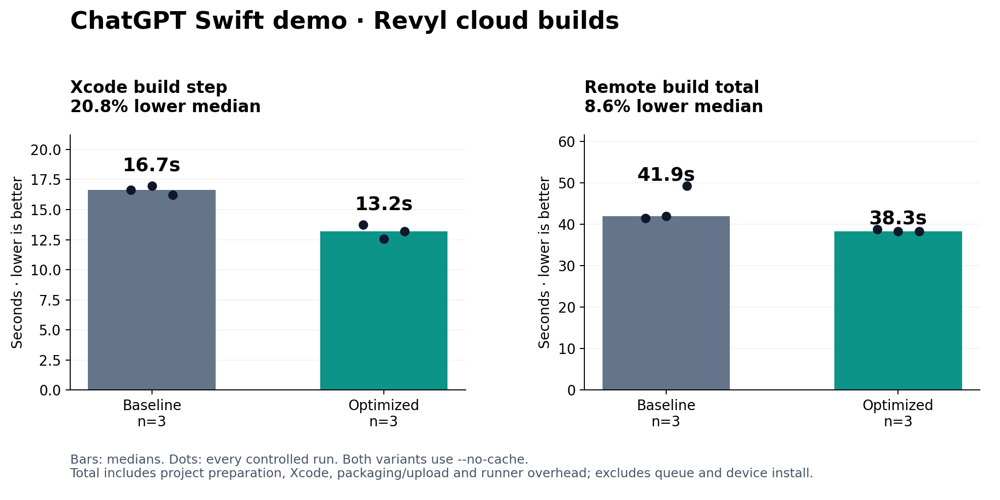
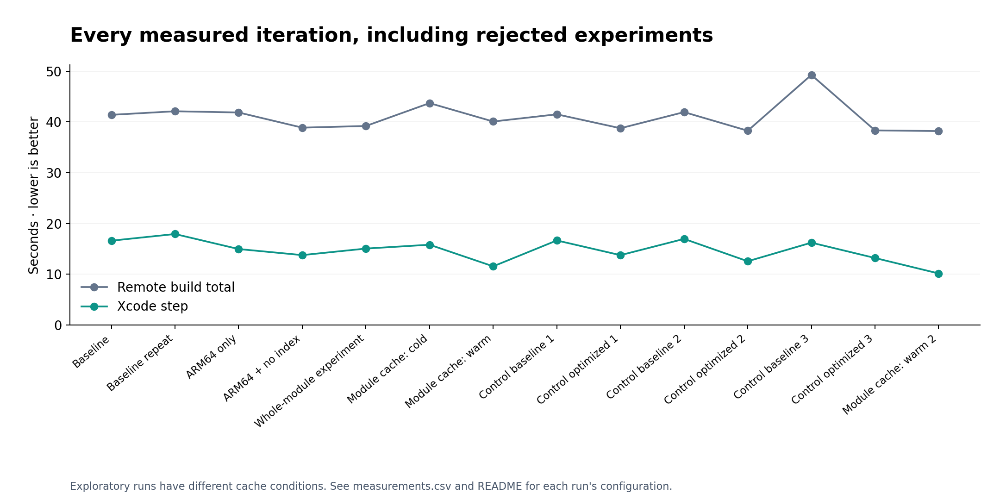

# Cloud build timings

Measured October 14, 2026 (America/Los_Angeles), from `6c8a75ae02c57f679f743d3e0749f3561eb33060`. App source is unchanged. All 14 remote builds succeeded.

**Controlled medians, three runs per variant:** Xcode **16.7s → 13.2s (20.8% lower)**; remote build total **41.9s → 38.3s (8.6% lower)**.

## Changes retained

The Revyl development recipe sets `ARCHS=arm64 ONLY_ACTIVE_ARCH=YES` for its ARM64 cloud simulator, disables IDE indexing with `COMPILER_INDEX_STORE_ENABLE=NO`, and prints `-showBuildTimingSummary`. Normal Xcode project settings remain unchanged. The cloud artifact no longer supports Intel simulators. Debug information, mock auth, and app behavior are retained.

These settings are documented in [Apple's build settings reference](https://developer.apple.com/documentation/xcode/build-settings-reference). This is the fastest repeatable configuration established in this experiment, not a claim of a global optimum.

## Method

Each controlled run used `revyl build --profile development --platform ios --no-cache --no-set-current --detach --json`, followed by `revyl build status <job-id> --follow --debug` and `--json`. The baseline uses the original recipe plus timing output; the optimized variant adds the architecture and indexing settings above. Runs alternate baseline/optimized. Both disable configured and runner compilation caches; the corresponding logs have no cache restores or CAS compilation enabled.

All runs use Debug, the ChatGPTDemo scheme, generic iOS Simulator, Xcode 27 (`27A266a`), and the iOS Simulator 27.0 SDK. Revyl provisions the cloud workers; physical runner identity/load is not controlled. Three samples per variant are descriptive, not a statistical guarantee.

`total_seconds` is the backend's build `duration_ms`, from started to completed. It includes preparation, Xcode, packaging/upload, and residual runner overhead. It excludes queue time, client source upload, device install, and interaction. `xcode_seconds` is the build step wall time, not the sum of parallel compiler-task durations. The CSV includes each step, the residual `other_seconds`, exact command, timestamps, version IDs, and job IDs. No successful samples were discarded. Baseline control 3 includes 10.396 seconds of residual overhead; its Xcode step was 16.220 seconds.

## All iterations

| Run | Xcode seconds | Total seconds | Configured module cache | Evidence |
| --- | ---: | ---: | --- | --- |
| Baseline | 16.605 | 41.395 | none | [logs](https://app.revyl.ai/apps/3c0e0458-75a0-4a38-bd4c-152d25d756cb/builds/4ae8f962-a783-44dd-941d-69ad2d5d34e0#logs) |
| Baseline repeat | 17.920 | 42.100 | none | [logs](https://app.revyl.ai/apps/3c0e0458-75a0-4a38-bd4c-152d25d756cb/builds/e0d40068-841b-4d31-93be-db8e8241d70b#logs) |
| ARM64 only | 14.959 | 41.860 | none | [logs](https://app.revyl.ai/apps/3c0e0458-75a0-4a38-bd4c-152d25d756cb/builds/d4c00da6-5384-427d-a2d8-5edf8983dd75#logs) |
| ARM64 + no index | 13.770 | 38.872 | none | [logs](https://app.revyl.ai/apps/3c0e0458-75a0-4a38-bd4c-152d25d756cb/builds/18977c78-175b-4bba-9ea8-bdebe800c699#logs) |
| Whole-module experiment | 15.055 | 39.201 | none | [logs](https://app.revyl.ai/apps/3c0e0458-75a0-4a38-bd4c-152d25d756cb/builds/944b216b-0145-4f49-9099-5c7af6a68dbf#logs) |
| Module cache: cold | 15.813 | 43.704 | miss | [logs](https://app.revyl.ai/apps/3c0e0458-75a0-4a38-bd4c-152d25d756cb/builds/da1f44a9-2d4c-49c7-905b-a86519492905#logs) |
| Module cache: warm | 11.555 | 40.080 | hit | [logs](https://app.revyl.ai/apps/3c0e0458-75a0-4a38-bd4c-152d25d756cb/builds/63ff4e22-bc0e-4c54-b5ea-97b665c414b4#logs) |
| Control baseline 1 | 16.655 | 41.500 | disabled | [logs](https://app.revyl.ai/apps/3c0e0458-75a0-4a38-bd4c-152d25d756cb/builds/d8ab706b-4803-4b17-b571-a845d42be255#logs) |
| Control optimized 1 | 13.756 | 38.755 | disabled | [logs](https://app.revyl.ai/apps/3c0e0458-75a0-4a38-bd4c-152d25d756cb/builds/475e2ad0-7a1b-4499-b179-2946aa30cfab#logs) |
| Control baseline 2 | 16.962 | 41.934 | disabled | [logs](https://app.revyl.ai/apps/3c0e0458-75a0-4a38-bd4c-152d25d756cb/builds/3c8df6c0-897f-465a-8a55-5a53a6c9c0b9#logs) |
| Control optimized 2 | 12.554 | 38.264 | disabled | [logs](https://app.revyl.ai/apps/3c0e0458-75a0-4a38-bd4c-152d25d756cb/builds/e6e1c641-a1a9-451b-a59d-baaa113d059c#logs) |
| Control baseline 3 | 16.220 | 49.257 | disabled | [logs](https://app.revyl.ai/apps/3c0e0458-75a0-4a38-bd4c-152d25d756cb/builds/e4a5313f-914d-4c04-823d-a39374bcf097#logs) |
| Control optimized 3 | 13.198 | 38.332 | disabled | [logs](https://app.revyl.ai/apps/3c0e0458-75a0-4a38-bd4c-152d25d756cb/builds/d5a06f99-fb04-4cc9-8a62-0598e08f6cbc#logs) |
| Module cache: warm 2 | 10.154 | 38.199 | hit | [logs](https://app.revyl.ai/apps/3c0e0458-75a0-4a38-bd4c-152d25d756cb/builds/a5fd11e3-f55e-477e-bd7e-087abf038ae2#logs) |

Exploratory runs have different cache conditions and are not pooled into the headline comparison. `none` means no configured path cache; `miss`/`hit` describe the experimental module cache; `disabled` means `--no-cache`. [Cache log excerpts](cache-log-excerpts.txt) record the separate runner compilation-cache state.

Whole-module compilation took 15.055s in Xcode versus 13.770s for the preceding incremental run, so it was not retained. A 28.9 MB module cache reduced compilation but added about two seconds to restore. Its warm totals were 40.080s and 38.199s (median 39.140s), offering no clear improvement over the uncached optimized recipe. The experiment cache was removed. One exploratory worker had Revyl's compilation cache enabled; others reported `omni-cache` missing. Controlled runs avoid that confound.

The final controlled recipe spends a median 22.058s in preparation. Faster runner provisioning/preparation and consistent runner compilation-cache availability are the next platform-level opportunities.

## Device verification

[Cloud session recording/report](https://app.revyl.ai/sessions/report?sessionId=5c887dc2-5243-4782-b9e5-82489571526b): iPhone 17 Pro Max, iOS 27.0. Codex used CLI device commands, not a manually created or run test suite.

- Baseline and ARM-only builds launched signed in and opened the seeded Hello conversation.
- Optimized build `7fb44cae-4899-43d2-b7a8-862856704470` passed auth bypass, saved chat loading, editing Hello to Explain UI design, regenerating the reply, searching for the edited message, and reopening the result.
- The final screenshot was inspected. App log snapshots were collected before and after; no fatal/crash markers were found in the optimized snapshot. OS BoardServices and launch-metric errors also occurred before optimization; this is not a claim of an error-free system log.
- The owned device session was stopped after verification.

## Reproduce the charts

With Python and matplotlib available, run `python3 scripts/plot-build-timings.py` from the repository root. It reads [measurements.csv](measurements.csv) and regenerates both PNG charts. No plotting dependency is required by the app.
